# Shardwise

A free, open-source MongoDB GUI for Windows, macOS and Linux. Query with a visual Filter Builder or in shell
syntax, browse results as a table, tree or JSON, edit documents in place, build aggregation pipelines stage by
stage, read explain plans, analyse schemas, and move data between MongoDB, files and SQL databases.

> **Please read [Before you use it](#before-you-use-it) first.** Shardwise was built mainly with an AI model,
> some features have so far been verified only by automated tests, and it comes with no warranty.
> Try it on a non-production database and keep a proper backup.

**[Download the latest release](https://github.com/mexusbg/shardwise/releases/latest)** ·
[Installation](#installation) · [Features](#features)

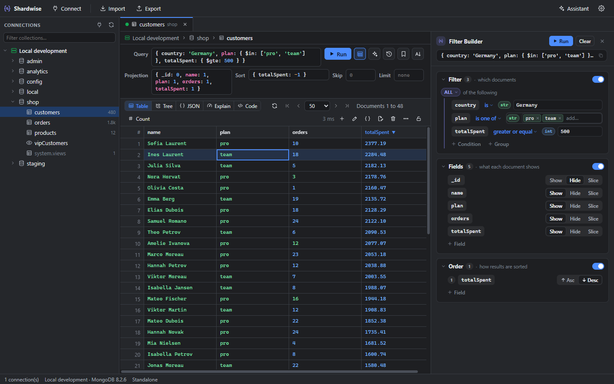

## Before you use it

**How it was made.** Shardwise was created mainly with Claude, Anthropic's AI model, under the direction of its
author.

**How it was tested.** The project has a large automated test suite: about 880 unit and integration tests, many of
them against a real MongoDB server, and an end-to-end test that clicks through the packaged app on Windows and
Linux. Some features have only been verified by these automated tests and have not yet been tested in everyday use
with real-world data. Expect rough edges, especially with unusual data, very large collections and less common
server setups. Bug reports are welcome.

**Use it safely.**

- Try Shardwise on a non-production database first, or on a copy of your data.
- Keep a proper, tested backup before you edit, delete, import, migrate, sync, mask or restructure data.
- Read-only connections and the read-only lock of a tab prevent accidental writes. Change History can undo many
  changes, but it is not a backup.

**No liability.** Shardwise is provided "as is", without warranty of any kind, express or implied. The author and
Fidweb are not liable for any loss of data, damage or other liability, whether in contract, tort or otherwise,
arising from the use of the software or the inability to use it. You use it at your own risk. See also the
[license](LICENSE).

## Features

### Connect to any deployment

- `mongodb+srv://`, standalone servers and replica sets, or paste a connection string.
- Authentication with SCRAM, X.509, LDAP, Kerberos and AWS IAM; TLS with your own CA and client certificates.
- SSH tunnels (password or key) that also work with SRV and replica sets; HTTP and SOCKS proxies.
- Passwords encrypted with the operating system's keychain, or asked for each time you connect.
- Folders and colours for connections, and read-only connections that refuse every write.
- Import connections from Studio 3T®, MongoDB Compass and Robo 3T exports; export them as URIs or as
  passphrase-encrypted JSON.

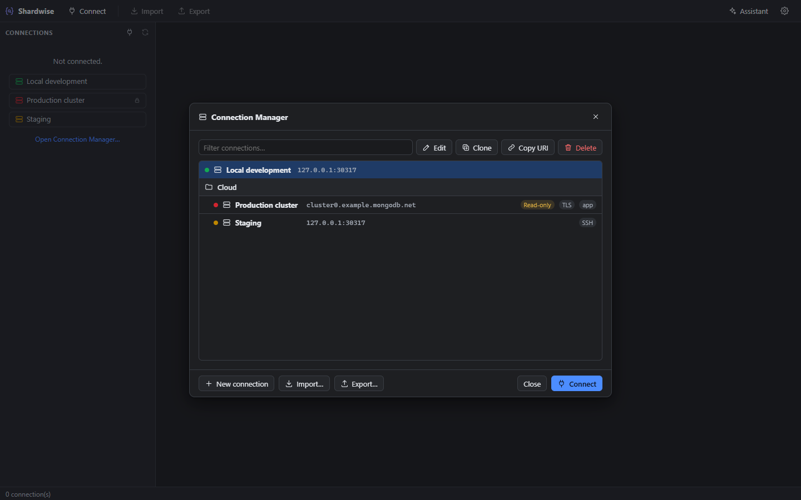

### Browse and query

- Query, projection, sort, skip and limit in shell syntax (`ObjectId("…")`, `ISODate("…")`, regex literals), with
  autocomplete of field names.
- **Filter Builder:** drag a cell or a column header into it to add a condition, a field or a sort order.
  `$and` / `$or` / `$nor` / `$elemMatch` groups, about 25 operators and typed values. It stays in sync with the
  query text in both directions.
- **Table**, **Tree** and **JSON** views. Step into nested fields, hide and resize columns, and sort by clicking a
  column header.
- Collation picker, paging, document counts, and default queries per connection, database or collection.
- **Ctrl+P** jumps to any collection by name. Typing in the connection tree jumps to the next matching name.
- **Find in Database** searches for a value across all collections of a database.
- Every query is kept in the query history. Save the ones you need in the Query Library, organised in folders.

| Tree view | Edit a document as JSON |
|---|---|
| 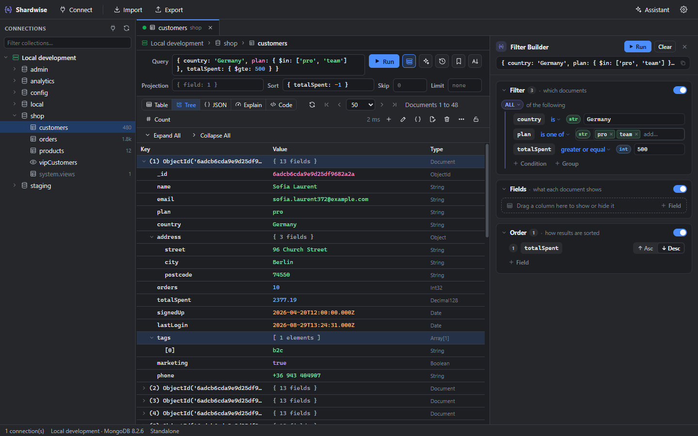 | 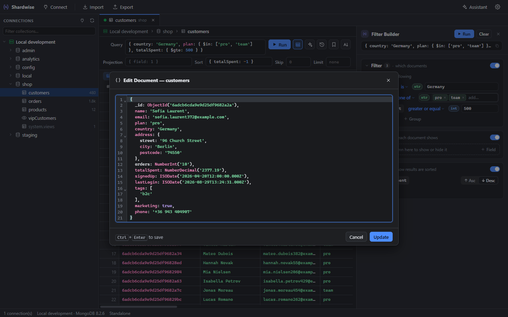 |

### Edit data

- Edit values in place, change a value's type with conversion, or edit the whole document as JSON (Ctrl+F finds
  text in it).
- Insert, paste and duplicate documents; set, rename, add and remove fields in one document, the matching
  documents or the whole collection.
- **Update** and **Delete** dialogs with an editable query and a live count of the documents that will change.
- **Change History** keeps the previous version of every document changed through Shardwise, in a local file,
  and restores it with one click.
- Lock a tab as read-only to prevent accidental edits. Edit validation rules and view definitions.

### Aggregation pipelines

Build a pipeline stage by stage from templates, with a preview of the input and output of every stage. Edit the
whole pipeline as text, run explain on it, save it, or create a view from it. A find query opens as a pipeline
in one click.

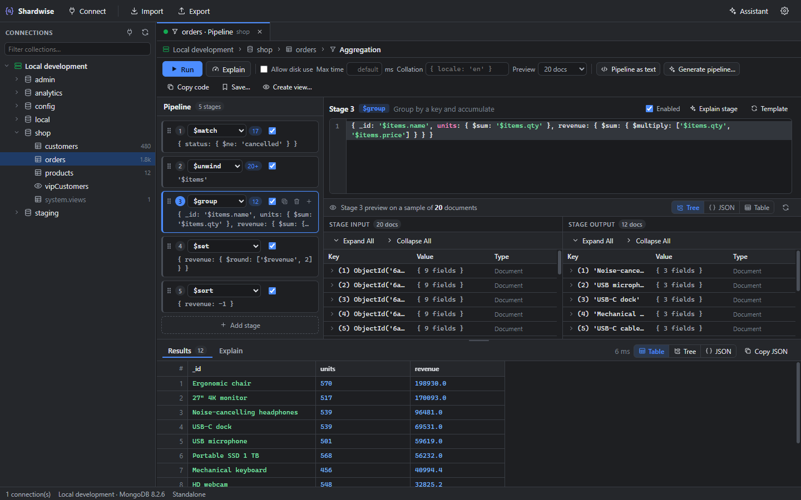

### Performance

- **Explain plans** as a visual stage tree with the key numbers up front. Warnings point out collection scans and
  in-memory sorts, and suggest an index.
- **Query Profiler** on `system.profile`: profiling levels, slow-operation threshold, operations grouped by query
  shape, and index suggestions. Current operations, with kill.
- **Index manager:** sizes, usage statistics, unused indexes, build progress, hide / unhide, and a full create
  dialog (compound, text, 2dsphere, hashed, wildcard, TTL, partial, collation).

| Explain plan | Index manager |
|---|---|
| 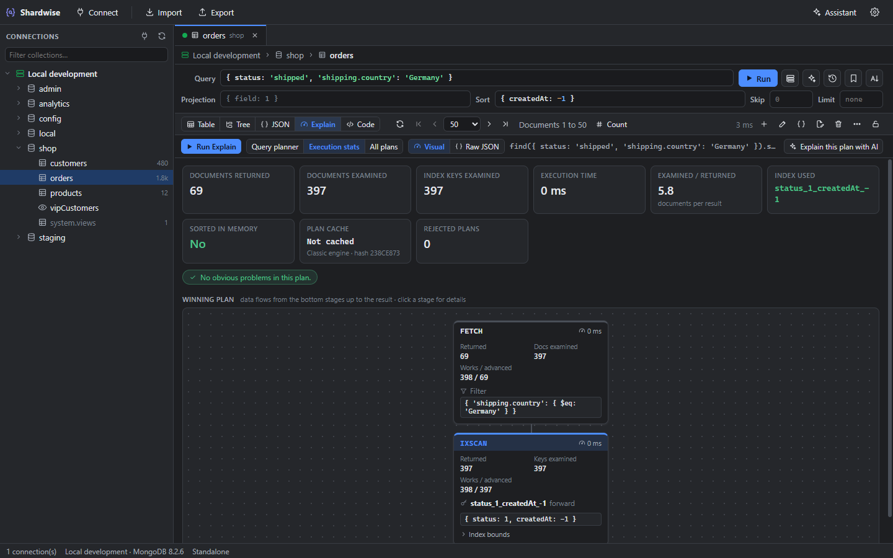 | 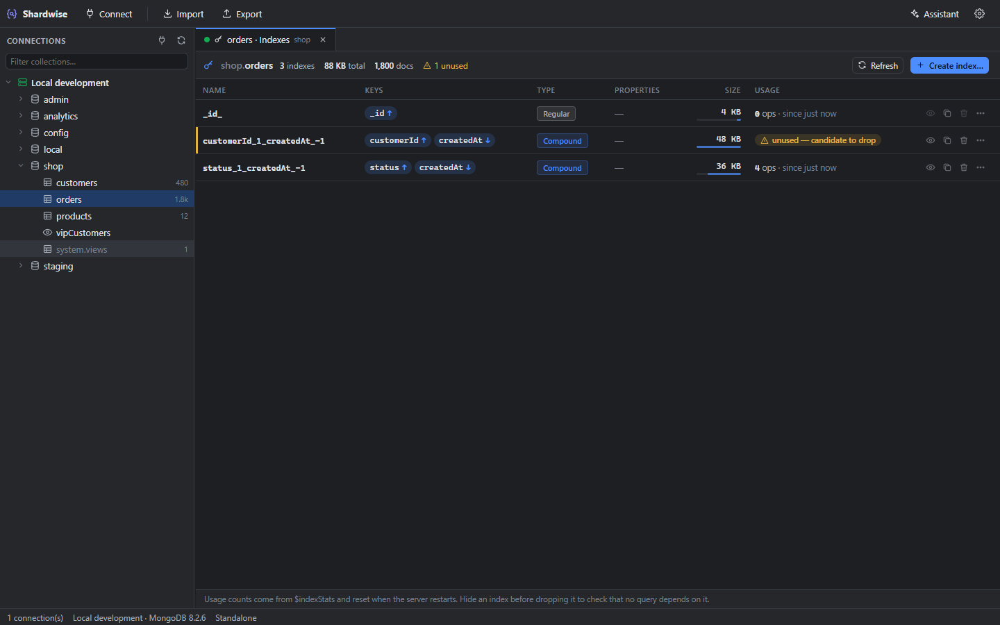 |

### Schema analysis

Field types, how often each field is present, statistics and top values from a sample. Mixed types are flagged.
Click a value to query it, and export the result as JSON Schema or as a validator.

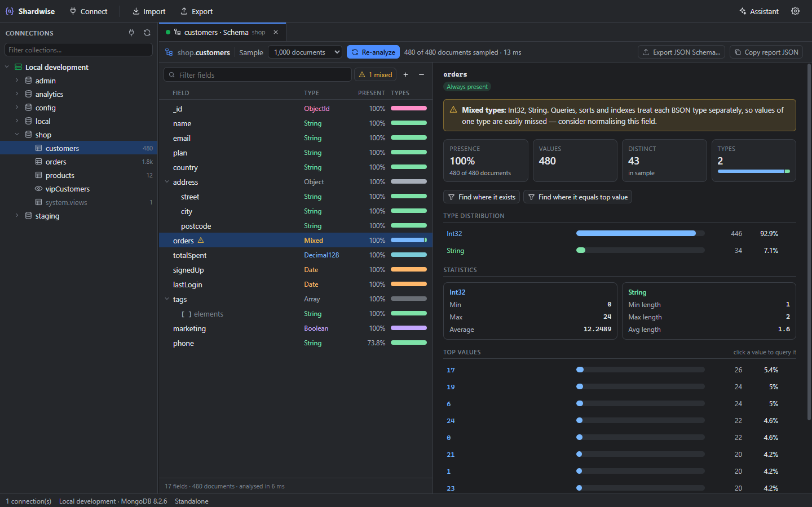

### Code

- **Playground:** JavaScript or TypeScript with the Node.js driver, mongosh-style `db.coll.find()`, and Mongoose
  (`Order.aggregate(...)` works without defining a schema). Scripts run in a background worker you can stop.
- **Shell:** a mongosh-style console with persistent variables, `use`, `show …`, `it` and history. It asks before
  running commands that drop or delete data.
- **Query Code:** the current query as mongosh, Node.js, Mongoose, Python, Java, C#, Go, PHP, Ruby or SQL.
- **SQL Query:** write SQL (WHERE, GROUP BY / HAVING, JOIN, functions) and run it as a find or an aggregation.

| Playground | Shell |
|---|---|
| 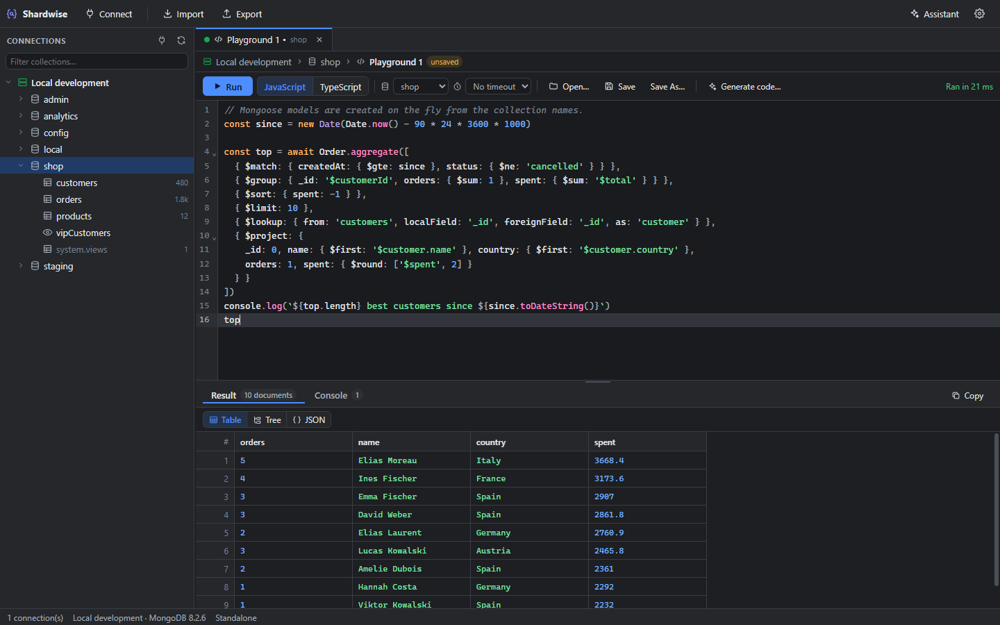 | 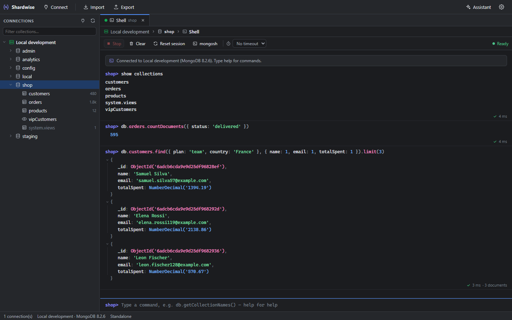 |

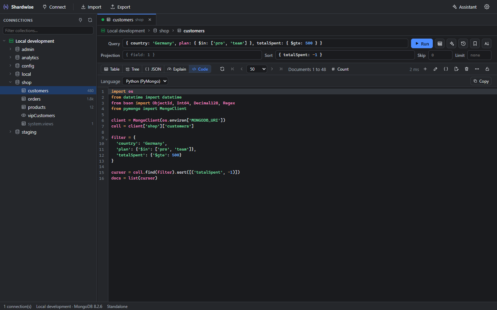

### Move and compare data

- **Import / export:** JSON (mongo shell, canonical and relaxed Extended JSON, plain JSON), CSV, Excel, and BSON
  through the bundled `mongodump` / `mongorestore` (folder or archive, gzip).
- **Copy and paste** collections and whole databases, also between connections, with their indexes and views.
- **Compare & sync:** compare two collections by a key field, field by field, and sync them with a dry run first.
- **MongoDB → SQL** and **SQL → MongoDB** for PostgreSQL, MySQL / MariaDB, SQL Server and SQLite. The relational
  mapping is inferred from a sample (flattened objects, child tables for arrays) and you can edit it, then migrate
  live or generate a `.sql` script.
- **Data masking** for safe copies and exports, and **Restructure Fields** to rename, move or retype fields
  across a collection, with a preview and a dry run.
- **GridFS** file browser, and **Tasks** that run saved imports, exports, syncs, migrations and masking jobs on
  demand or on a schedule.

| Compare & sync | MongoDB → SQL |
|---|---|
| 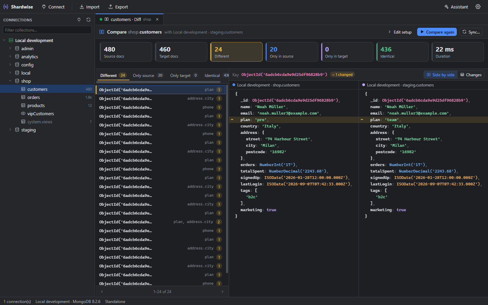 | 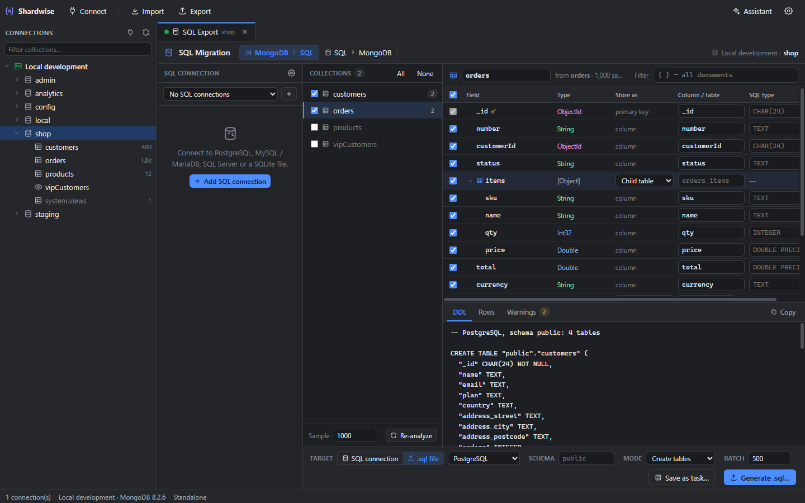 |

### AI helper (optional)

Describe a query or a pipeline in plain language and the AI writes it; ask it to explain an explain plan or a
stage; chat with an assistant that can run read-only queries. It works with Claude (Anthropic) or any
OpenAI-compatible service: OpenAI, Gemini, Mistral, Groq, OpenRouter, DeepSeek, or a local model with Ollama or
LM Studio. You bring your own API key, which is stored encrypted. Only field names and types are sent unless you
allow sample documents. A local MCP server lets external AI agents (Claude Code, Cursor, VS Code…) query the
connections you choose.

### Administration and settings

- Server Status dashboard with live charts, and Users & Roles (built-in and custom roles, privileges).
- Dark and light themes, colours for each value type, rebindable keyboard shortcuts, date formats and time zones,
  and a search box in Settings.

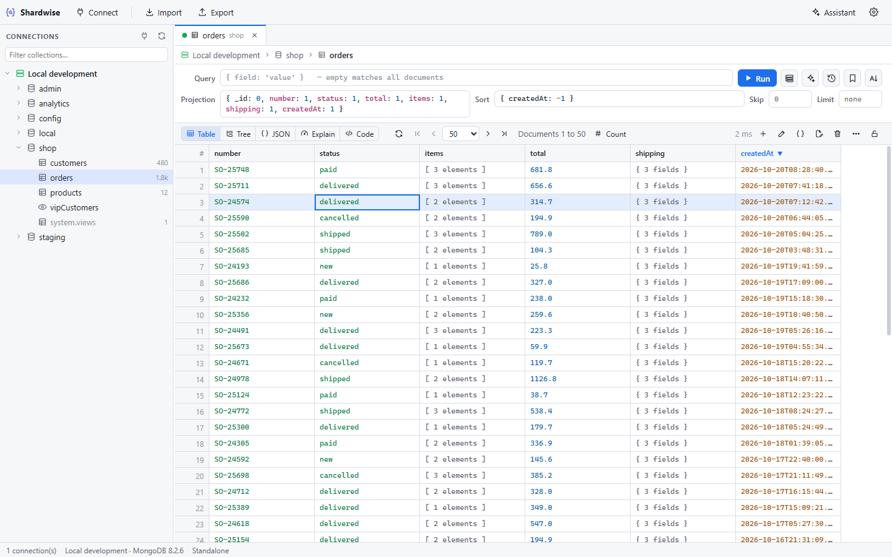

## Author and support

Made by [Fidweb](https://fidweb.net). Author: mexus.

If Shardwise is useful to you, you can support its development on [Ko-fi](https://ko-fi.com/mexus).

## Installation

Download the installer for your system from the
[latest release](https://github.com/mexusbg/shardwise/releases/latest):

| System | File |
|---|---|
| Windows 10 / 11 (x64) | `Shardwise-<version>-win-x64.exe` |
| macOS on Apple Silicon (M1 or newer) | `Shardwise-<version>-mac-arm64.dmg` |
| Linux x64 | `Shardwise-<version>-linux-x86_64.AppImage` or `Shardwise-<version>-linux-amd64.deb` |

The builds are not code-signed yet, so each system shows a one-time warning the first time you start Shardwise.
Intel Macs are not supported.

### Windows

1. Run `Shardwise-<version>-win-x64.exe`.
2. If a blue SmartScreen box says "Windows protected your PC", click **More info**, then **Run anyway**.
3. Follow the installer. It lets you choose the folder and creates Start menu and desktop shortcuts.

To uninstall: **Settings → Apps → Installed apps → Shardwise → Uninstall**.

### macOS (Apple Silicon)

1. Open the `.dmg` and drag **Shardwise** into **Applications**.
2. Open Shardwise. macOS blocks it because the build is not notarized.
3. Go to **System Settings → Privacy & Security**, scroll to the message about Shardwise, click **Open Anyway**
   and confirm with your password.

If there is no Open Anyway button, or macOS says the app "is damaged", run this once in Terminal and open it again:

```bash
xattr -dr com.apple.quarantine /Applications/Shardwise.app
```

### Linux

**Debian / Ubuntu (.deb):**

```bash
sudo apt install ./Shardwise-<version>-linux-amd64.deb
```

**Any distribution (AppImage):** the AppImage is the program itself, no installation needed.

```bash
chmod +x Shardwise-<version>-linux-x86_64.AppImage
./Shardwise-<version>-linux-x86_64.AppImage
```

- If it fails with `dlopen(): error loading libfuse.so.2`, install FUSE 2: `sudo apt install libfuse2` on
  Ubuntu 22.04, `sudo apt install libfuse2t64` on Ubuntu 24.04 and later.
- If it exits with a "SUID sandbox helper" error (Ubuntu 24.04 and later), start it with `--no-sandbox`, or use
  the `.deb`.
- For a menu entry and dock icon, use [AppImageLauncher](https://github.com/TheAssassin/AppImageLauncher) or
  [Gear Lever](https://github.com/mijorus/gearlever).

### Updates

Shardwise checks GitHub for a newer release when it starts and shows a link in the status bar when one is
available. Nothing is downloaded or installed without you; turn the check off in **Settings → About**. To update,
install the new version over the old one: settings and saved connections are kept.

## Development

Requires Node.js 24 (see `.nvmrc`).

```bash
npm install
npm run dev          # start the app with hot reload
npm test             # unit + integration tests (downloads a MongoDB binary on first run)
npm run typecheck
npm run build && npm run e2e   # launch the built app against a seeded in-memory MongoDB, save screenshots to .e2e/screens
node scripts/readme-screens.mjs # after a build: regenerate the README screenshots in screenshots/ (sample data only)
```

If you run commands from a terminal inside VS Code, unset `ELECTRON_RUN_AS_NODE` first, otherwise Electron
starts as plain Node.

## Packaging

```bash
npm run dist:win     # NSIS installer
npm run dist:mac     # dmg (Apple Silicon), must run on macOS
npm run dist:linux   # AppImage + deb
```

From Windows, the Linux and macOS packages can be built in WSL (Ubuntu with nvm; no compiler needed):

```bash
wsl.exe -d Ubuntu-22.04 -- bash scripts/wsl-build.sh linux mac
```

The macOS build made on Linux is a `.zip` of `Shardwise.app` (a dmg needs macOS), ad-hoc signed with
[rcodesign](https://github.com/indygreg/apple-platform-rs) so Apple Silicon runs it.

Installing the builds: see [Installation](#installation). For the `.zip` made in WSL: unzip it, move
`Shardwise.app` to Applications and follow the macOS steps; if it still refuses to start, re-sign it locally with
`codesign --force --deep --sign - /Applications/Shardwise.app`.

Supported targets: Windows 11 x64, Linux x64 (AppImage, .deb), macOS on Apple Silicon (arm64).
Each `dist:*` script first downloads the official MongoDB Database Tools (Apache-2.0) for that target into
`resources/tools/<os>-<arch>/`; `mongodump` / `mongorestore` ship inside the app, so nothing needs installing.
`npm run tools:fetch` does the same for the current machine (used by `npm run dev`).

Installers land in `release/<version>/`. The GitHub Actions workflow in `.github/workflows/build.yml` tests
every push and pull request and builds all three platforms; pushing a version tag (`git tag v0.3.0 && git push
origin v0.3.0`) also creates a GitHub release with the installers attached. Builds are unsigned; add signing
certificates via electron-builder environment variables when needed.

### Update checks

At launch (and with **Settings → About → Check now**) the app asks GitHub for the latest release of the
repository named in `package.json` → `repository` ([mexusbg/shardwise](https://github.com/mexusbg/shardwise)) and
shows a link to the release page when it is newer. Nothing is downloaded or installed automatically, and users can
turn the check off. Releases come from version tags such as `v0.3.0` (see above); drafts and pre-releases are
ignored.

## Layout

| Path | What |
|---|---|
| `src/shared` | Pure logic shared by both processes: query-builder model, BSON value typing, connection URIs, API contract |
| `src/main` | Electron main process: MongoDB driver, SSH tunnel, saved connections, import/export jobs |
| `src/preload` | Minimal IPC bridge |
| `src/renderer` | React UI |
| `tests` | Vitest unit and integration tests (mongodb-memory-server, in-process SSH server) |

## Trademarks & independence

Shardwise is an independent project. It is not affiliated with, endorsed by or sponsored by MongoDB, Inc.,
3T Software Labs (Studio 3T) or any other vendor. MongoDB is a trademark of MongoDB, Inc.; Studio 3T is a
trademark of 3T Software Labs; Robo 3T and other names are trademarks of their respective owners. They are
mentioned only to describe compatibility (for example, importing connection exports from those tools).
No third-party source code, artwork or text is included.

Third-party open-source components and their licenses are listed in `THIRD_PARTY_NOTICES.md` (shipped with
the app); the bundled MongoDB Database Tools are Apache-2.0 licensed, with their LICENSE and notices included.

## License

[MIT](LICENSE) © 2026 mexus (Fidweb). Third-party components keep their own licenses (see `THIRD_PARTY_NOTICES.md`).
